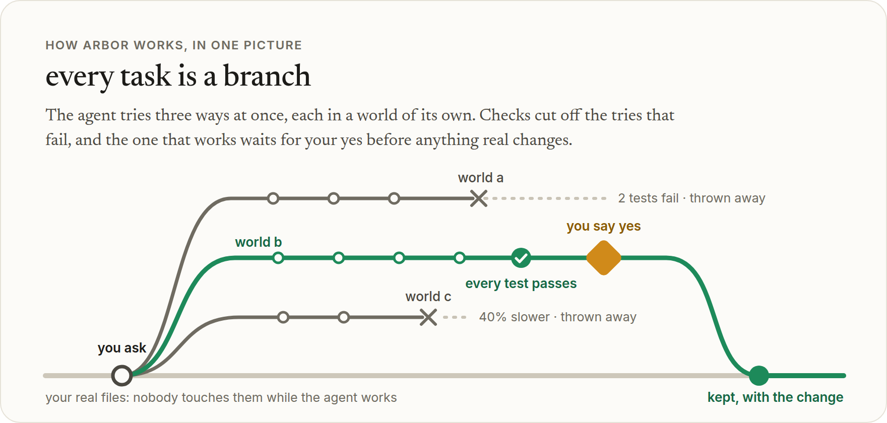
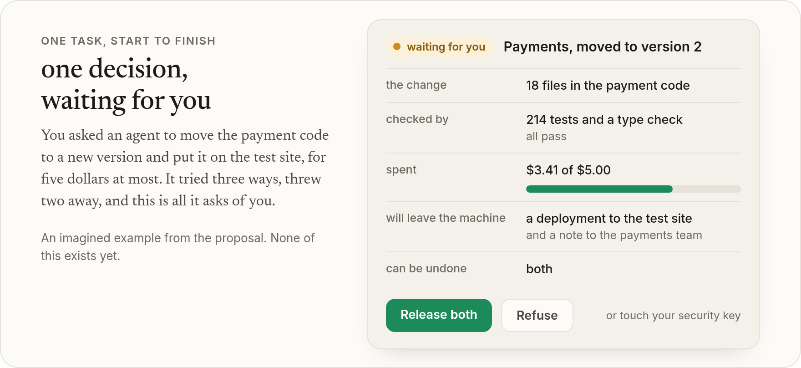
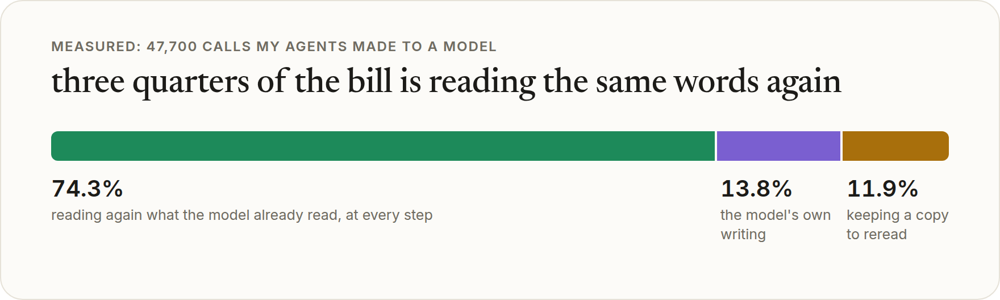
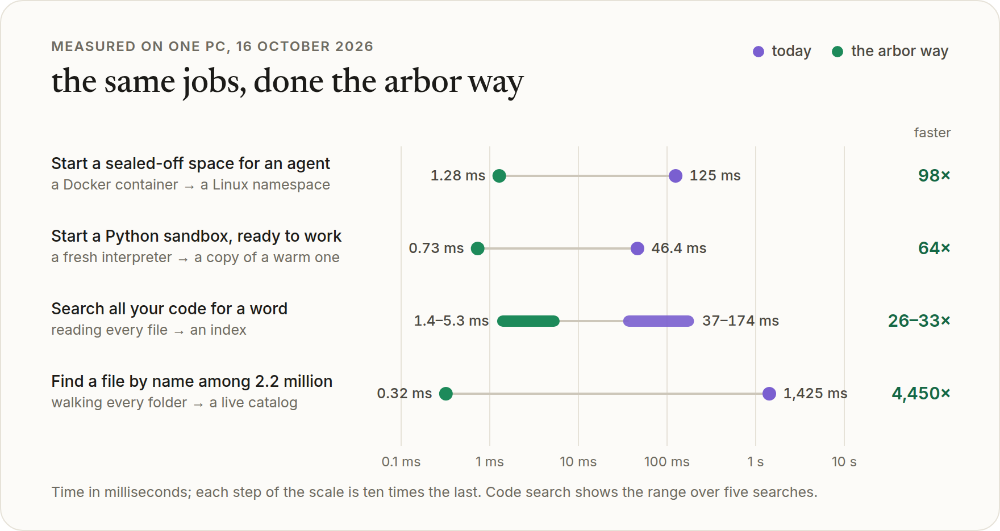

<div align="center">
  
  <h1>arbor</h1>
  <p><strong>An operating system built for AI agents, and for the people who direct them.</strong></p>
  <p>
    Every computer you have used was built for one person at a keyboard.<br>
    Agents are now some of the busiest users our machines have.<br>
    arbor is a plan to rebuild the computer around them, measured on a real PC first, and its first piece runs on today's Linux.
  </p>
  <p>
    
    
    
    <a href="https://github.com/NahuelGenchi/arbor/actions/workflows/checks.yml"></a>
    <a href="https://nahuelgenchi.com/software/arbor/"></a>
  </p>
  <p>
    <a href="#in-one-minute">In one minute</a> &nbsp;·&nbsp;
    <a href="#what-you-get">What you get</a> &nbsp;·&nbsp;
    <a href="#the-five-goals-scored">Goals</a> &nbsp;·&nbsp;
    <a href="#one-task-start-to-finish">One task</a> &nbsp;·&nbsp;
    <a href="#measured-not-guessed">Measured</a> &nbsp;·&nbsp;
    <a href="#try-the-prototype">Try it</a> &nbsp;·&nbsp;
    <a href="#where-it-stands">Roadmap</a>
  </p>
</div>

<p align="center">
  <picture>
    <source media="(prefers-color-scheme: dark)" srcset="docs/images/hero-dark.webp">
    
  </picture>
</p>

> [!NOTE]
> **arbor is not built yet.** This repository holds what comes first: a report of where memory, disk, time, energy and money go on a computer that agents use every day, the tools to measure it again, and a first prototype that runs on today's Linux. The numbers on this page were measured on one PC, except the few marked as estimates and the imagined example of how a task would go.

## In one minute

**An agent** is a program that uses an AI model, the kind behind Claude, ChatGPT or Gemini, to get a job done on its own. You give it a goal, and it does the hundred small steps in between: it reads files, runs programs, searches the web, writes code and, more and more often, spends money.

**An operating system** is the software underneath everything else on a computer: Windows, macOS, Android, Linux. Think of it as the management of a large building. It hands out rooms and keys, keeps the lights and water running, and keeps the list of who may go where.

The trouble is that every operating system in use today descends from ideas of 1969, made for a handful of people typing at terminals. They assume:

- that **one person** sits at the keyboard, when an agent may run hundreds of copies all night;
- that a program may do **anything its user may**, when an agent can be tricked by a single web page it reads;
- that a saved file **replaces** the old one, when an agent wants to try ten ways and quietly throw nine away;
- that programs talk in **text laid out for human eyes**, which an AI has to guess its way through.

**arbor** keeps what made those systems great, a few simple ideas that everything else is built from, and swaps the ideas for ones that fit agents. The good news is that the better ideas are not new: most were built and tested decades ago, and lost only because they asked too much paperwork of people. That paperwork is exactly the patient, exact work that software does without effort.

## What you get

<table>
  <tr>
    <td width="50%" valign="top">
      <h3>💸 A smaller bill</h3>
      Three quarters of what agents cost goes on reading the same words again and again. Cutting what they reread is arbor's first job. Its first attempt, shorter answers for agents, makes each answer far shorter but has not yet lowered what a whole session costs.
    </td>
    <td width="50%" valign="top">
      <h3>⚡ Much faster</h3>
      On the same PC, a safe space for an agent starts about 100 times faster, and a file is found among 2.2 million in a third of a millisecond.
    </td>
  </tr>
  <tr>
    <td width="50%" valign="top">
      <h3>↩️ Undo for everything</h3>
      An agent works on a copy of everything it can see. Keep the result, or throw the copy away whole, with nothing left to clean up.
    </td>
    <td width="50%" valign="top">
      <h3>🔑 Safe to hand over</h3>
      Like a valet key for a car: an agent gets exactly the access its task needs, for as long as it lasts, and never sees your passwords.
    </td>
  </tr>
  <tr>
    <td width="50%" valign="top">
      <h3>📮 Nothing leaves without you</h3>
      Payments, emails and posts wait in an outbox until a rule or a person releases them, and leave exactly once, with a receipt.
    </td>
    <td width="50%" valign="top">
      <h3>🪶 A lighter machine</h3>
      One shared service instead of a heavy program for every agent and a browser for every app, and a third of the disk back from files stored twice.
    </td>
  </tr>
</table>

## The five goals, scored

On 18 October 2026 arbor was given five goals: far fewer resources than a normal operating system, far more power, far less energy, safe to use, and easy, with a beautiful design. Each is scored here on something a person would notice over a stretch of work, not on one operation: today's Ubuntu against the same work done with arbor, on the PC under [Measured, not guessed](#measured-not-guessed), by the suite's [`goals` section](bench/README.md#sections) ([#85](https://github.com/NahuelGenchi/arbor/issues/85)).

The work: three agent-like tries of a change to this repository at once. Each searches the code, edits it, builds its Rust workspace and runs the tests, twice; then one try is kept and two are thrown away. No AI model runs, only the commands an agent runs, so what the agents' own programs take (250–334 MiB each, in the report) is not in it. Today's way is a `git worktree` per try, as coding agents use them now, or a copy of the folder; arbor's is a world per try, with its commands in sealed cells. Each number is the median of 3 runs, the lowest and highest in brackets, and all are **M**, measured on 18 October 2026; the design row has no number.

| goal | measured as | today: worktrees | today: copies | arbor | where arbor stands |
| :--- | :--- | ---: | ---: | ---: | :--- |
| **Fewer resources** | memory and swap in use, peak above the start | 4,454 MiB (4,332–4,511) | 1,182 MiB (758–1,232) | **436 MiB** (354–629) | ahead, because a world starts with the folder's build already done: worktrees build everything again, and copies, at a new path, part of it. The agents' own programs are not in it, and arbor does not make them smaller yet |
| | written to disk | 3,426 MiB (3,418–3,509) | 4,567 MiB (4,550–4,778) | **2,208 MiB** (2,206–2,209) | ahead, by a third against worktrees: the worlds' builds still write their output |
| **More power** | the whole stretch, end to end | 32.5 s (32.4–33.0) | **10.1 s** (10.0–10.1) | 14.3 s (12.2–14.4) | **behind copies**, though it used 16 s of CPU against their 45 s: builds in a cell wait on something, and the first one after the edit takes 6.9–8.5 s against 2.6 s in a copy. The cause is not found yet, and two other runs took 5 s |
| | 5 tries of a change at once, keep 1, throw 4 away | 6.6 s (6.6–6.7) | 7.9 s (7.8–9.1) | **4.1 s** (3.8–5.5) | ahead |
| | undo a kept try: of 5 places it changed, as before | 4 | not run: the same git steps | **5** | ahead: today a file the try wrote outside the project stays changed, and an ignored file such as `.env` is never kept. The undo itself is slower: 7.7 ms against git's 2.3 ms (one run) |
| **Less energy** | package energy over the stretch (RAPL) | 4,236 J (4,198–4,254) | 937 J (907–945) | **648 J** (607–668) | ahead, from doing less CPU work, so it carries the same caveat as memory |
| | a still desktop, package power over 150 s blocks | 22.3 W (one block) | | 22.1 W (22.0–22.1), with Mission Control open | **the same**: arbor adds nothing measurable, and does not lower what the desktop itself draws; that is [M5](#where-it-stands), not built |
| **Safe** | 13 probes of what an agent can reach: logins, transcripts, your files, the project's real folder, the network, localhost, Docker, the session bus, your other programs, an effect without a yes, 512 MiB of memory, the kernel's keyrings | reaches 13, as you | the same | **reaches 0** | ahead: in a cell under a typical agent's key, every probe was blocked |
| **Easy** | start an agent safely: a copy of the project, one host, none of your logins | no stock way | the same | **3 commands** | ahead, in commands: Mission Control cannot start an agent yet ([#84](https://github.com/NahuelGenchi/arbor/issues/84)) |
| | approve one effect an agent asked for | nothing waits: it runs at once | the same | 2 commands | **behind** an agent's own prompt, one key press where the agent has one; Mission Control could not approve when this was measured ([#82](https://github.com/NahuelGenchi/arbor/issues/82) adds it) |
| | keep a try, then throw 4 away | 3 + 8 commands | 3 + 4 | **1 + 4** | ahead |
| **Beautiful design** | | | | | not measured: there is no measure of it yet, and Mission Control is a first, read-only window |

What the numbers do not say. The work is short and built from one Rust project, so arbor's lead in memory, disk and energy comes mostly from one thing, a world reusing the folder's build, and will differ with other work. The still desktop had one clean block for today, as someone used the PC during the others, and `arbor serve` ran in both arms (2.7 MiB, idle). The package energy was read through RAPL, which only root may read on this PC: the owner opened it to ordinary users for these runs and closed it again, since an energy counter anyone can read is a side channel. Run it again with `ONLY=goals bench/run.sh`.

## The new building blocks

Today's computers are built from users, programs, files and text. arbor is built from these, and it is named after the Latin word for tree because almost everything in it branches.

| the idea | what it replaces | think of it as |
| :--- | :--- | :--- |
| **World** | a disk and its folders | a draft of everything an agent can see, copied in an instant, then kept or thrown away |
| **Object** | a file | a piece of data that knows what it is and is never written over: each change is a new version |
| **Cell** | a program, container or virtual machine | a sealed room where work happens, ready in a fraction of a millisecond |
| **Key** | a user account and its password | a valet key: one job, on one thing, until a set time, within a set budget |
| **Effect** | *(new)* | anything that reaches the outside world, like an email or a payment, held in an outbox first |
| **Channel** | pipes and text | a line between two cells that carries clear, typed messages instead of text to be guessed at |
| **Budget** | *(new)* | what a task may spend: money, time, energy and people's attention |

Under all of them runs **the ledger**, a record of every step every agent takes: what it did, who allowed it, what it read and what it cost.

## One task, start to finish

You ask an agent to update the payment code of a small online shop and put it on the test site, for five dollars at most. It tries three ways at once, each in a world of its own. Checks throw away the two that fail, at no cost to your real files. Nothing has reached the real server or your team's chat yet. What is left is a single card:

<p align="center">
  <picture>
    <source media="(prefers-color-scheme: dark)" srcset="docs/images/decision-dark.webp">
    
  </picture>
</p>

You say yes, and the change and both messages go out together, or not at all. If a tester finds a problem two days later, one command puts everything back as it was.

## Measured, not guessed

Before building anything, arbor measured where the waste is on one ordinary PC that runs coding agents every day: an Intel Core i7-14700KF with 15 GiB of memory on Ubuntu 26.04, and 201 agent sessions that made 47,700 calls to a model.

**Most of an agent's bill is rereading.** At every step, the model reads the whole conversation again. A cache makes that cheap, and it is still three quarters of the cost:

<p align="center">
  <picture>
    <source media="(prefers-color-scheme: dark)" srcset="docs/images/bill-dark.webp">
    
  </picture>
</p>

**The jobs agents do all day can be far faster.** These are the same jobs, on the same PC, done today's way and the arbor way:

<p align="center">
  <picture>
    <source media="(prefers-color-scheme: dark)" srcset="docs/images/measured-dark.webp">
    
  </picture>
</p>

<details>
<summary><strong>The same numbers as a table, with a few more</strong></summary>

| the job | today | the arbor way | how |
| :--- | ---: | ---: | :--- |
| Start a sealed-off space for an agent | 125 ms | **1.28 ms** | a Linux namespace instead of a Docker container |
| Start a Python sandbox, ready to work | 46.4 ms, 15.2 MiB | **0.73 ms, 2.1 MiB** | a copy of a warm one instead of a fresh start |
| Search all your code for a word | 37–174 ms | **1.4–5.3 ms** | an index instead of reading every file |
| Find a file by name among 2.2 million | 1,425 ms | **0.32 ms** | a live catalog instead of walking every folder |
| Make a private copy of a 28 GB project to try an idea | | **4.3 ms** | a copy-on-write snapshot: nothing is copied until it changes |
| List 100 files for an agent | 6,283 tokens | **401 tokens** | only the names it asked for, not a page of formatted text |
| Show an agent the last 20 changes to some code | 18,928 tokens | **530 tokens** | only the fields it asked for |
| Disk taken by the projects folder | 70.5 GiB | **47.6 GiB** | each piece of content stored once (a third was exact copies) |
| Time to start the PC | 25.2 s | **≈13 s** (est.) | one kernel image, nothing at boot that can wait, resume instead of restart |

All measured on the PC above, except the boot time after the change, which is an estimate. The token rows count one answer. Over whole agent sessions, the shorter answers have not saved anything yet: see [Try the prototype](#try-the-prototype).
</details>

The full report, with every source and the things arbor should refuse to do even where they look faster, is in **[OPTIMIZATION.md](OPTIMIZATION.md)**.

## Try the prototype

The first piece of arbor runs on today's Linux, with no administrator rights. It is one program, `arbor`, and it already has worlds, sealed commands, keys, limits, a network open only to the hosts a key names, the outbox, the ledger and short answers for agents: try a change on an instant copy of a folder, keep it or throw it away whole, and let nothing leave the machine until you say yes.

You need Linux with [bubblewrap](https://github.com/containers/bubblewrap) 0.10 or later (on Ubuntu 26.04, `sudo apt install bubblewrap`) and [Rust](https://rustup.rs). Then, in a copy of this repository:

```sh
cargo install --locked --path prototype/arbor
```

And with any folder you work in:

```sh
arbor new shop --from ~/projects/shop   # an instant copy: nothing is copied until something changes
arbor shell shop                        # work inside it, sealed off; the real folder does not change
arbor diff shop                         # what changed
arbor keep shop                         # put the changes in the real folder; arbor undo takes them back
```

`arbor run shop -- npm test` runs one command instead of a shell. Inside a world your home folder is empty, so tools installed there, such as `~/.nvm`, need a key that opens them: `arbor key new dev --toolchains`, then `arbor run shop --key dev -- npm test`.

A world has no network either, until a key names the hosts it may reach over HTTPS. That lets an agent work in a world of its own: after `arbor key new agent --toolchains --read ~/.local/share/claude --env ANTHROPIC_API_KEY --net api.anthropic.com --home`, Claude Code started in `arbor shell shop --key agent` reaches its API and nothing else, keeps its settings from one run to the next in a home folder of the key's own, and what it changes waits in the world until you keep it. OpenCode runs there too, with the login of its plan copied into that folder: see [OpenCode, with the login it already has](prototype/README.md#opencode-with-the-login-it-already-has).

An agent asks for what it reads with `arbor look`: several reads in one call, each a short table of only the fields it wants. `arbor look status + log -n 5 + files src` answers what changed, the last five commits and what a folder holds in one step instead of three, and `arbor look` alone describes all it answers, so the agent's prompt needs no tool description for it. A large file it reads in parts: `arbor look outline FILE` gives what the file defines and the lines each spans, and `arbor look lines FILE 120-164` only the lines of the one it needs.

How fast it is on the PC above. Every number here is **M**: the suite's [`arbor` section](bench/README.md#sections) measured it on 17 October 2026, except the output of `ls -la`, `git log -20` and `ps aux` in brackets, which the report measured the day before, and the last column names its row in [`bench/lib/reference.py`](bench/lib/reference.py).

| the job | the prototype | suite row |
| :--- | ---: | :--- |
| Make a world: an instant copy of a folder | 2.0 ms | `arbor.new_ms` |
| Start a command in it, sealed off | 5.1 ms | `arbor.run_cgroup_ms` |
| Start it with the network open to one host | 5.7 ms | `arbor.run_net_ms` |
| From inside, connect through arbor to a server on this PC (directly: 0.03 ms) | 0.15 ms | `arbor.tunnel_ms`, `arbor.tunnel_direct_ms` |
| From inside, ask for something only you can allow, such as a `git push` | 0.6 ms | `arbor.ask_ms` |
| Run it once you say yes, with a receipt | 1.5 ms | `arbor.release_ms` |
| Put 1,000 new files in the real folder, or take them back out | 6.2 ms, 4.1 ms | `arbor.keep_ms`, `arbor.undo_ms` |
| Tell an agent what changed in 100 files | 700 tokens | `arbor.diff100_tokens` |
| Show an agent what a folder of 100 files holds (`ls -la`: 2,776 tokens) | 422 tokens | `arbor.look_files_tokens` (`fmt.ls_human`) |
| Show an agent the last 20 commits (`git log -20`: 18,928 tokens) | 579 tokens | `arbor.look_log_tokens` (`fmt.git_log`) |
| Show an agent the 30 programs using the most memory (`ps aux`: 9,900 tokens) | 325 tokens | `arbor.look_procs_tokens` (`fmt.ps_aux`) |
| Show an agent 15 changes in a repository (`git status`: 244 tokens) | 128 tokens | `arbor.look_status_tokens`, `arbor.git_status_tokens` |
| Show an agent a large file's outline, then also two of its functions (the whole file: 100%) | 4.2%, 8.5% of its tokens | `arbor.outline_pct`, `arbor.outline_read_pct` |
| Answer what changed, the last commits and a folder's files in one call | 2.7 ms | `arbor.look_ms` |
| Describe to an agent all that `arbor look` answers | 413 tokens | `arbor.look_about_tokens` |
| Memory of the one background service it keeps running | 2.7 MiB | `arbor.serve_rss_mib` |

A sealed command starts about 24 times faster than the Docker container above (125 ms), though not yet in the 1.28 ms of a plain Linux namespace: the prototype also mounts the world over the folder, sets up the command's limits, filters the kernel calls it may make, and records each step in the ledger. Opening the network to one host adds 0.6 ms to the start, and passing through arbor 0.12 ms to each connection. `arbor look` answers in 3–15% of the tokens of `ls -la`, `git log -20` and `ps aux`, and in about half those of `git status`, which is already short. Read in parts, a large file costs far less than whole: on this repository's ten largest code files, the outline is a median 4.2% of a file's tokens, and the outline with two of its functions 8.5%, close to what the report found on 40 other files (4% and 8%). Asking for three reads at once could also save two of the steps that make an agent reread its whole conversation, which cost about 42,000 input-token equivalents each on the PC above (the step's cost is **M**; the saving is arithmetic, **est.**). Measured over whole sessions, neither has saved anything yet: in an A/B of 119 sessions of OpenCode on its free model, doing six small tasks on this repository, the agent told to read with `arbor look` got about two fifths less text back from its tools but took about a quarter more steps, and its weighted tokens came out the same, 1.01 times the other's (95% interval 0.85–1.15) (**M**, 17 October 2026, [*Whole agent sessions*](bench/README.md#whole-agent-sessions); a free remote model's answers vary, so a new run will not repeat these numbers exactly). A second A/B, of 156 sessions, told the agent to find with grep first and then make every read in one call, with `arbor look` in the shell or as a tool of its own. It took as many steps as the agent without it (1.02 and 0.98 times), but it no longer read less, and its weighted tokens came out 1.05 and 1.04 times the other's (95% intervals 0.86–1.23 and 0.84–1.19): still no saving (**M**, 17–18 October 2026, same section). What a command in a world can and cannot do, and how keys, the network, limits, the outbox, the ledger and `arbor look` work, is in **[prototype/README.md](prototype/README.md)**.

## Measure your own PC

The measurements are a suite of scripts you can run on a Linux PC. It needs no administrator rights, only reads your files, writes nothing but a temporary folder and its own report, and takes about two and a half minutes. With Rust set up for the prototype, it also builds the prototype in that temporary folder and measures it the same way, in about 15 seconds more; if the prototype's background service is not running, it starts it for those rows and stops it again. Last, on a Wayland desktop, it spends about two minutes on the screen: for one minute nothing should touch the PC, then a small window of its own animates, first on a quiet PC and then with every core busy and most of the free memory taken:

```sh
git clone https://github.com/NahuelGenchi/arbor.git
cd arbor/bench
./run.sh
```

It writes a report to `bench/results/` with every number next to the one measured for arbor, and why any of them differ. Run only some parts with `ONLY="boot search" ./run.sh`. What it needs, what it reads and how to read the report are in **[bench/README.md](bench/README.md)**.

> [!TIP]
> Close other programs first. A busy PC reads 20–40% slower, and the report says when that happened.

## Where it stands

arbor is planned in steps. The first prototype is a layer on top of Linux, so today's programs keep working inside it; the whole of it, with new hardware, is a project of about ten years. Each step is a milestone:

- 🟢 **[M0 · Project foundation](https://github.com/NahuelGenchi/arbor/milestone/1)** — this repository, its documents and how work is tracked
- 🟢 **[M1 · Measurements](https://github.com/NahuelGenchi/arbor/milestone/2)** — the report and the suite; the baseline of 16 October 2026 is done, and the suite measures the prototype too
- 🟢 **[M2 · Worlds and storage](https://github.com/NahuelGenchi/arbor/milestone/3)** — instant copies of everything, each piece of content stored once, finding anything at once. *In the prototype: worlds of a folder, kept or undone whole*
- 🟢 **[M3 · Cells](https://github.com/NahuelGenchi/arbor/milestone/4)** — sealed rooms that start in a fraction of a millisecond, and the keys that open them. *In the prototype: sealed commands with limits, keys, a filter on kernel calls, and a network open only to the hosts a key names*
- 🟢 **[M4 · Agent layer](https://github.com/NahuelGenchi/arbor/milestone/5)** — agents that reread less: tools described on demand, short typed answers, one shared service. *In the prototype: `arbor look`, several reads in one call, each a short table*
- ⚪ **[M5 · Lean system](https://github.com/NahuelGenchi/arbor/milestone/6)** — memory, starting up and energy: no swapping to disk, no waiting at boot, nothing that polls
- 🟢 **[M6 · Outbox and ledger](https://github.com/NahuelGenchi/arbor/milestone/7)** — effects that wait for a yes, budgets, and the record of every step. *In the prototype: the outbox, budgets in money, and the ledger*
- 🟢 **[M7 · Interface](https://github.com/NahuelGenchi/arbor/milestone/8)** — Mission Control, the screen where people direct agents ([the brief](docs/INTERFACE.md)). *In the prototype: a first window, in GTK 4, that shows the tries, the rooms working in them, the decisions waiting and the last steps, and cannot answer yet*

<sub>🟢 in progress &nbsp;·&nbsp; ⚪ planned</sub>

## Read more

<table>
  <tr>
    <td width="50%" valign="top">
      <a href="https://nahuelgenchi.com/software/arbor/"><strong>The operating system agents need</strong></a><br>
      <sub>Part 1. The proposal: why today's systems cannot simply be patched, the seven building blocks, keys and the outbox, and how it could be built one step at a time.</sub>
    </td>
    <td width="50%" valign="top">
      <a href="https://nahuelgenchi.com/software/arbor-measured/"><strong>arbor, measured</strong></a><br>
      <sub>Part 2. Where one computer's memory, time and tokens really go, and what arbor should build first, take out and refuse because of it.</sub>
    </td>
  </tr>
</table>

## In this repository

| path | what it is |
| :--- | :--- |
| [`OPTIMIZATION.md`](OPTIMIZATION.md) | The report: the waste measured today, the top 10 changes for the prototype, and every source |
| [`bench/`](bench/) | The suite that measures it all again, section by section, and the prototype the same way; also an A/B of whole agent sessions with and without `arbor look` |
| [`prototype/`](prototype/) | The first prototype, on today's Linux: one program, `arbor`, with worlds, sealed commands, keys, limits, a network open only to the hosts a key names, the outbox, the ledger and short answers for agents; and [Mission Control](prototype/mission/README.md), a first window that shows what it is doing |
| [`docs/INTERFACE.md`](docs/INTERFACE.md) | The design brief for Mission Control, the screen where people will direct agents. Only its first, read-only window exists |
| [`docs/images/`](docs/images/) | The pictures on this page, and the pages they are drawn from |

Work is tracked from issue to branch to milestone to pull request; see [CONTRIBUTING.md](CONTRIBUTING.md) and [docs/TRACKING.md](docs/TRACKING.md).
