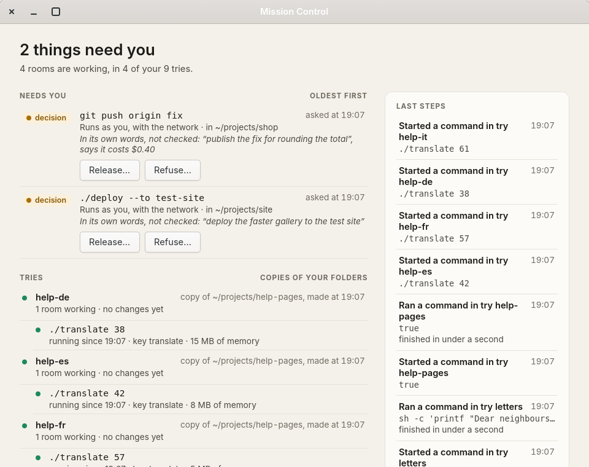
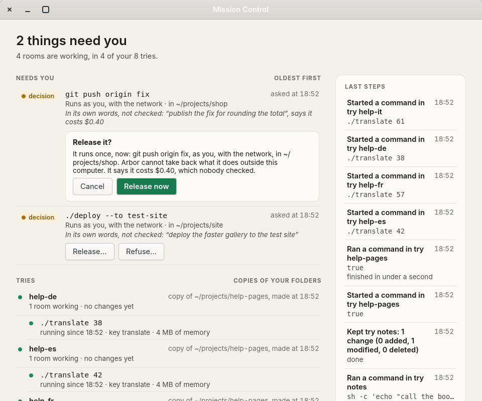
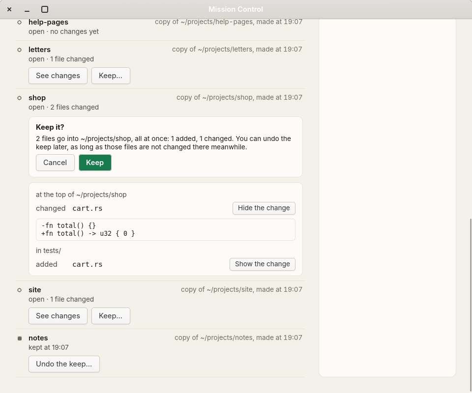
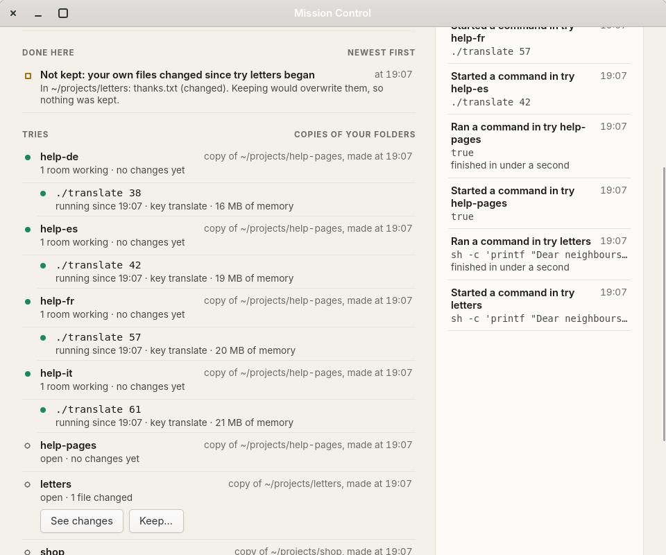

# Mission Control

The first Mission Control app ([#9](https://github.com/NahuelGenchi/arbor/issues/9)): one window on today's desktop that shows what arbor is doing, in the plain words of the design brief ([`docs/INTERFACE.md`](../../docs/INTERFACE.md)). It is written in Rust with GTK 4, through the gtk4-rs bindings, the toolkit [#8](https://github.com/NahuelGenchi/arbor/issues/8) chose. It answers decisions, with Release and Refuse ([#82](https://github.com/NahuelGenchi/arbor/issues/82)), and shows what a try changed, keeps it into your folder and undoes the keep ([#83](https://github.com/NahuelGenchi/arbor/issues/83)); everything else it only shows.



The window shows, from arbor's own state folder:

- **Needs you**: the effects waiting in the outbox for a person, each with its command, where it runs, what it says it costs and why, in the agent's own words and marked as not checked, and **Release** and **Refuse**.
- **Done here**: what you did from the window, newest first: a released command's receipt (how it ended, how long it took, how much it printed and the first lines of it), the refusal and your reason, or a try kept or its keep undone, and, when arbor would not, why.
- **Tries**: every world, working ones first, with the rooms working in each (the cells running there), their command, key, memory and share of a processor, and what changed in words (*3 files changed*), with **See changes** and **Keep** on an open try that changed something, and **Undo the keep** on a kept one. Past 12 tries, and past 3 rooms in a try, the rest fold into one line.
- **History**: the ledger's last 8 steps, newest first. A step that arrives later does not push the list down under the reader's eyes: a line says *There are 2 newer steps*, and a button shows them.

## Build and run

It needs GTK 4.14 or later with its development files (`sudo apt install libgtk-4-dev` on Ubuntu 24.04 and later) and the Rust toolchain pinned in [`../rust-toolchain.toml`](../rust-toolchain.toml). In `prototype/`:

```sh
cargo build --release -p mission     # target/release/arbor-mission
cargo install --locked --path mission  # or install it into ~/.cargo/bin
```

`arbor-mission` opens the window on the state of the `arbor` command: `~/.local/share/arbor`, or `$ARBOR_HOME`. By itself it changes nothing there and starts nothing. Ctrl+W or Ctrl+Q closes it.

## Release and Refuse

Each decision has two buttons. Neither does anything at once:

1. **A press asks first, in place.** Under the decision, a short box says what will happen: for Release, that the command runs once, now, as you, with the network, in that folder, and that arbor cannot take back what it does outside the computer; for Refuse, that it will not run, with a box for your reason, which arbor keeps with the refusal and tells a try that waits for the answer. The focus moves to **Cancel**, so a held or repeated Enter never confirms. Escape, or Cancel, goes back to the button.
2. **Confirmed, the window runs arbor's own command**: `arbor release ID`, or `arbor refuse ID --why REASON`, the `arbor` next to `arbor-mission` or else the one on the `PATH`. It is the command a person would type, so the outbox's rules apply (a key taken back, a budget spent, a folder that is not there) and the ledger records the step with you as the actor: the window has no other way to send anything off the computer. The command is a process of its own, run off the window's main thread, and it goes on if the window closes, so an effect is never cut off halfway by closing it.
3. **The receipt.** The decision leaves Needs you at once, and its line in Done here says *Releasing: running since 14:07* until the command ends, then how it ended (*Released: it finished*, *it failed with exit code 3*), how long it took, how much it printed, and the first six lines of that, which can be selected and copied. The tooltip has the receipt's SHA-256. When arbor will not do it, the line says why in arbor's words (*Not released: key 'agent' was taken back…*), and the decision comes back.

<p align="center">
  <picture>
    <source media="(prefers-color-scheme: dark)" srcset="../../docs/images/mission-app-confirm-dark.webp">
    
  </picture>
</p>

By keyboard: Tab reaches each button, Enter presses it, Tab moves from Cancel to the action, and Enter confirms. On the accessibility bus each button is named after its decision (*Release git push origin fix*), Cancel and the action are described by the sentence above them, and each result is announced politely (*Released ./deploy --to test-site: it finished*).

## See changes, Keep and Undo

An open try that changed something has **See changes** and **Keep…**; a kept try has **Undo the keep…**.

1. **See changes** opens, under the try, its files in plain words, grouped by folder, the top of the folder first: *changed cart.rs*, *added cart.rs* in *tests/*, *removed old.txt*. Each text file has **Show the change**, which shows up to 40 of its changed lines, as `arbor diff --patch` gives them without the line numbers, in a box that can be selected and copied. When your own folder changed since the try began, the view says first that a keep would be refused, and which files, in plain words (*thanks.txt (changed)*). Seeing changes asks nothing and changes nothing.
2. **Keep…** asks first, in place, as Release does: *2 files go into ~/projects/shop, all at once: 1 added, 1 changed. You can undo the keep later, as long as those files are not changed there meanwhile.* The focus moves to **Cancel**. Confirmed, the window runs `arbor keep NAME`, and the line in Done here says *Kept try shop: its changes are in ~/projects/shop*. When arbor refuses because your own files changed meanwhile, nothing is kept, and the line says so and names them: *Not kept: your own files changed since try letters began*, *In ~/projects/letters: thanks.txt (changed). Keeping would overwrite them, so nothing was kept.*
3. **Undo the keep…** asks the same way, then runs `arbor undo NAME`: what the keep put into your folder comes back out, and the try is open again. It is refused, with the files, when any of them changed in your folder since the keep.

<p align="center">
  <picture>
    <source media="(prefers-color-scheme: dark)" srcset="../../docs/images/mission-app-keep-dark.webp">
    
  </picture>
</p>

<p align="center">
  <picture>
    <source media="(prefers-color-scheme: dark)" srcset="../../docs/images/mission-app-refused-dark.webp">
    
  </picture>
</p>

The buttons are named after their try on the accessibility bus (*Keep try shop*, *See what try shop changed*, *Show the change to tests/cart.rs*), and each result is announced politely (*Kept try shop: its changes are in ~/projects/shop*, or *2 files changed in try letters; keep would be refused*).

## Try it

To try it without your own folders, `mission/demo.sh` makes a home with five small projects and an arbor state folder in a temp folder: nine tries, four rooms working (each holds some memory and waits), two decisions waiting, a kept try, and a try whose own folder changed after it began, so that keeping it is refused. Then it opens the window there. Closing the window stops the rooms and removes the folder. It needs bubblewrap 0.10 or later and, for the rooms' memory and processor, a systemd user session; it starts `arbor serve` if it is not running, and stops it again.

```sh
cargo build --release -p arbor -p mission --bins --example shot
mission/demo.sh                              # the window
mission/demo.sh shot demo.png dark 960x800   # or draw it into a picture, as the one above was
mission/demo.sh shot answered.png light 960x800 answered   # after pressing: confirm, refuse, releasing, answered,
                                                            # changes, keep, kept, refused
```

The site's decision runs a made-up `./deploy` that waits 2 s and prints a line; nothing leaves the computer. The scenes press the window's own buttons: `releasing` and `answered` really run `arbor release`, and `answered` also refuses the shop's `git push` with a reason; `kept` really keeps try shop into the made-up folder, and `refused` presses Keep on try letters, which arbor refuses.

## How it keeps still

- **It reads only when arbor writes, and only what changed.** The window watches the ledger with inotify (GLib's file monitor), since every change to worlds, cells and the outbox is a step there, and polls nothing. It reads at most once a second, on a thread of GLib's pool, and then changes only the words that changed. The ledger is read from where the last reading stopped, and a reading reads again only what its new steps name: those worlds, the cells they start or end, and the outbox after a step about an effect. While the ledger keeps moving, the window stops watching it and reads it on each calm second instead, so its writes wake nothing; once a reading finds nothing new, it watches again.
- **Rooms are sampled, not followed.** While rooms with a cgroup run, their memory and processor, the list of running cells and the files changed in the tries they work in are read again every 10 s; with none, nothing is.
- **A hidden window reads nothing.** When the desktop says the window is not seen (GTK's `suspended`, a minimised window for one), readings wait until it is shown again, and then one reading catches up.
- **Motion is short and rare.** A new line arrives from 12 px higher and fades in, in 200 ms, easing out, at most 5 at once; more than that just appear. Only the line's drawing moves, never the layout. Under the desktop's reduced motion, or with its animations off, nothing moves.

## Accessibility and look

- Each line reads as one sentence on the accessibility bus, for example *Decision waiting since 14:05: run git push origin fix, as you, with the network, in ~/projects/shop, asked from try shop. In its own words, not checked: “publish the fix for rounding the total”, says it costs $0.40.* The heading and the sections are headings there, and each line can be reached with the keyboard.
- Only what needs a person is announced, politely: *A decision is waiting: git push origin fix*, or *2 decisions are waiting*, when new ones arrive, and the result of an answer you gave. Routine progress is not.
- A state is never shown by colour alone: each has a word and a mark with a shape of its own (a diamond for a command that finished, a bar for a refusal, a hollow square for a failure).
- The colours are the brief's, which meet WCAG 2.2 AA in both themes. Release now's button is a darker green than the brief's, white on `#187a4f` (5.3:1) in light and dark ink on `#2f9e6c` (5.3:1) in dark, since white on the brief's green is 4.3:1. With GTK 4.20 or later the window follows the desktop's light or dark setting and its high contrast; before 4.20 it is light. Sizes follow the desktop's text size, and below 820 px the two columns become one.

## Measured

`ONLY=mission bench/run.sh` measures the window as the suite measured #8's test programs, on arbor state that it makes in its temp folder ([`bench/README.md`](../../bench/README.md)). The section is about fifteen minutes long, and the PC has to be left alone while it runs. The measurements below come from runs on 18 October 2026, from an ordinary process: nothing running from #9's run at 13:02, 300 rooms from #78's run at 14:17, after the window was changed to read only what new steps name, and the buttons from the run at 21:02, on the PC of [the toolkits measured](../../docs/INTERFACE.md#the-toolkits-measured). Each figure is one sample, and each first frame is the median of 5 launches. [*The first app, measured*](../../docs/INTERFACE.md#the-first-app-measured) has every row, the conditions, and what the numbers mean.

| Measure (M: every number in the row) | Nothing running | 300 rooms | Target |
| :--- | ---: | ---: | :--- |
| First frame, ms (M) | 174 | 200 | at most 200 |
| Memory after a minute, RSS / PSS, MiB (M) | 141 / 60 | 162 / 84 | at most 128 / 64 |
| Still screen: frames a second / CPU, % of a core / wakeups a second (M) | 0 / 0.00 / 0.10 | 1.0 / 0.33 / 12.5 | 0 / 0.1 / 0.1 still; 1 / 1 busy |
| Animation: frames missed idle / under load, % (M) | 0.42 / 15.1 | 0.17 / 4.9 | none / 0.1 |
| Work per frame, slowest 1%, ms (M) | 0.58 | 8.98, with a room sample every second | at most 4 |
| Release or Refuse: from the press to its confirmation on screen, ms (M) | 24 | 25 | at most 33 |
| Release now / Refuse now: from the press to the receipt, ms (M) | 39 / 42 | 47 / 45 | |

With nothing running, the window meets the still-screen targets. With 300 rooms, it shows one frame a second and uses 0.33% of a core, within the "busy but calm" target of 1; before it read only what new steps name, it used 2.37% (M, #9's run). Most of the memory is the GPU driver. Drawn with GTK's cairo renderer (`GSK_RENDERER=cairo arbor-mission`), the same window with nothing running uses 54 MiB of RSS and 24 MiB of PSS (M).

## For developers

| Path | What |
| :--- | :--- |
| `src/state.rs` | reading arbor's state: everything the first time, then only what the ledger's new steps name (worlds and their changes, the cells started or ended, the outbox's waiting effects), and every running cell with what each uses at the 10 s sample |
| `src/words.rs` | the plain words of every line, its buttons and their confirmations, and what each line says on the accessibility bus |
| `src/act.rs` | what the buttons run: `arbor release`, `arbor refuse`, `arbor keep` and `arbor undo`, as processes of their own, and what they did read back: the effect with the start of what it printed, or the try; and a try's changes, conflicts and changed lines, for See changes |
| `src/ui.rs` | the window: its sections, updating only the lines that changed, the file monitor, which rests while the ledger moves, and the calm second, the room sampling, the announcements, and the pictures `examples/shot.rs` draws |
| `src/shift.rs` | the widget that moves and fades a line as it is drawn |
| `src/mission.css` | the look: the brief's colours, light, dark and high contrast |
| `demo.sh` | made-up worlds, rooms and decisions, and the window on them |
| `tests/answer.rs` | Release and Refuse as the buttons run them, against an outbox of made-up effects |
| `tests/keep.rs` | See changes, Keep and Undo as the buttons run them, on a made-up try, and a keep refused because the folder changed |

`arbor-mission --bench still`, `--bench animate`, `--bench answer TRY` and `--bench keep TRY` are for the suite's `mission` section ([`bench/README.md`](../../bench/README.md)): `animate` moves the first decision without end, as #8's test program moves its card, and reads ten times as often as the window does: the ledger every 100 ms and the rooms every second. `answer` releases and refuses in turn every decision that try TRY asked for, with the window's own buttons, prints for each how long the confirmation and the result took to reach the screen, and closes. `keep` does the same three times with See changes, Keep and Undo the keep on try TRY. `../check.sh` lints and tests the app with arbor when GTK's development files are there.
